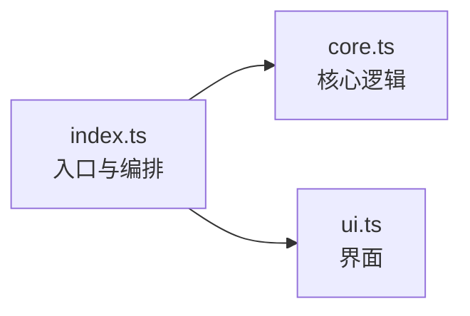
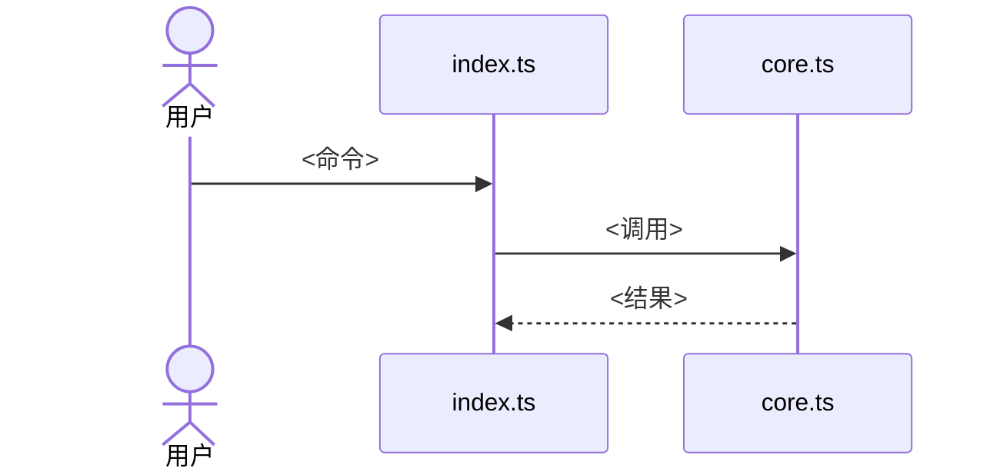

# 文档写作规范

文档语言：中文。`docs/notes/` 不限。

本仓库的文档同时给人和 Agent 读。每个扩展的文档放在自己目录里，按需分层，读者读到够用即停。

## 分层

| 层 | 文件 | 何时需要 | 读者的问题 |
|---|---|---|---|
| L0 | `AGENTS.md`、根 `README.md` | 始终 | 仓库里有什么，从哪进入 |
| L1 | `extensions/<name>/README.md` | 每个扩展 | 这是什么，怎么跑起来 |
| L2 | `docs/usage.md` | 有命令、工具或交互 | 怎么用 |
| L2 | `docs/configuration.md` | 有配置项 | 有哪些键，默认值是什么 |
| L2 | `docs/architecture.md` | 模块 ≥5 个，或有跨文件约束 | 改代码前要知道什么 |
| L3 | `docs/notes/YYYY-MM-DD-<topic>.md` | 调研、实验、决策 | 当时为什么这么选 |

没有内容可写的文件不创建。单文件扩展只需要 README。

## 写法

内容

1. 只描述已实现的行为。
2. 现在时，肯定句，主语是功能本身：「`/commit` 根据暂存区 diff 生成提交信息」。
3. 示例优先于解释。每个命令、工具先给一个可复制的例子；配置给一个完整示例。
4. 动作写具体行为：写「提交成功后退出 Pi」，不写「调用关闭接口」。
5. 示例用占位值（`provider/model-id`），不用个人环境的真实值；自动写入的字段不放进示例。
6. 枚举类取值列全，或给出 schema 文件路径。
7. 需要提醒读者的坑，用一行写在相关内容旁边，只写读者真会遇到的。

结构

8. 页面自洽：不跳转也能完成该页的任务。必需信息就地写出，一句话的事实可以重复。
9. 只对大块或易变的内容链接（schema、配置参考、shared 的详细行为）。链接用于深入，不用于理解当前内容。shared 的能力写一句摘要，细节链接过去。
10. README、usage、configuration 正文链接不超过 3 个，页尾「相关文档」不计。architecture 可以引用源码路径。
11. README 和 usage 不出现源码路径、常量名、函数名，这些只在 architecture 出现。
12. 同一功能的配置键，其他文档提到的必须在 `configuration.md` 中出现。
13. `architecture.md` 的「约束」只写改代码时必须保持的事实，每条说明目的或违反后果：
    - ✅ 展示截断（15 行）不得影响提交内容。
    - ❌ 审阅 UI 返回操作值，index.ts 持有完整消息。
14. 文件地图只列源码文件，测试写在「测试」一节，`package.json` 不列。

图

15. `architecture.md` 的模块关系和数据流用 Mermaid 图，不用编号步骤。每张图只讲一件事，节点不超过 10 个，节点文字自解释（文件名或角色），不用 A、B、C。节点文字含括号、冒号时用引号包裹。
16. 图只画稳定的结构和主流程。分支和异常用图后一行文字补充，不在图下复述图中内容。
17. 模块关系图只在模块 ≥3 个时画。

禁止

18. 不写：非目标、不支持清单、免责声明、背景铺垫、对未来的承诺。
19. 禁用词：本文档旨在、需要注意的是、请务必、切勿、可能会、一般来说、建议谨慎。
20. 链接用相对路径。

## 长度上限

- README ≤ 60 行
- usage、configuration ≤ 150 行
- architecture ≤ 200 行

超出时拆分，或删掉读者用不到的部分。

## 模板

### README.md

~~~markdown
# <扩展名>

<一句话：它做什么。>

## 安装

<安装命令或配置片段。>

## 快速开始

<最小可运行示例，附一句预期结果。>

## 文档

- [使用](docs/usage.md)
- [配置](docs/configuration.md)
- [架构](docs/architecture.md)
~~~

只列实际存在的文档。

### docs/usage.md

~~~markdown
# 使用

## <命令或工具名>

<一句话说明。>

```
<示例>
```

| 参数 | 说明 |
|---|---|
| ... | ... |
~~~

每个命令或工具一节，按用户使用频率排序。

### docs/configuration.md

~~~markdown
# 配置

配置位置：`<路径>`，配置键 `<key>`。

| 键 | 类型 | 默认值 | 说明 |
|---|---|---|---|
| ... | ... | ... | ... |

## 示例

```json
...
```

字段的校验规则见 `<schema 文件路径>`。
~~~

只有表格和一个完整示例。

### docs/architecture.md

~~~markdown
# 架构

<一段话：整体怎么工作。>

## 模块关系



## 文件地图

| 文件 | 职责 |
|---|---|
| `index.ts` | ... |

## 数据流



<一行：分支、取消、失败时的行为。>

## 约束

- <改代码时必须保持的事实，每条一行，写明目的或违反后果。>

## 测试

<怎么跑，测试文件对应哪些模块。>
~~~

「约束」是 Agent 改代码前最需要的一节：写跨文件的不变量，不写显而易见的事。

### docs/notes/YYYY-MM-DD-topic.md

~~~markdown
# <主题>

日期：YYYY-MM-DD
结论：<一句话。>

## 过程与数据

...
~~~

notes 记录当时的判断，允许与现状不同，不被其他文档引用为现行行为。

## 提交前检查

- [ ] 每个文件在分层表中有对应层级
- [ ] 没有禁用词和免责声明
- [ ] 每个命令有示例，配置有完整示例
- [ ] 每页不跳转也能完成任务；正文链接数在限制内
- [ ] README、usage 没有源码路径和实现名
- [ ] usage 提到的配置键都在 configuration 中
- [ ] architecture 的模块关系和数据流是 Mermaid 图，语法可渲染
- [ ] 约束每条写明目的或后果
- [ ] 没有大段复述 shared 或其他扩展的内容
- [ ] 行数在上限内
- [ ] 链接可打开
