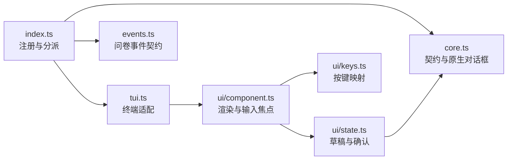
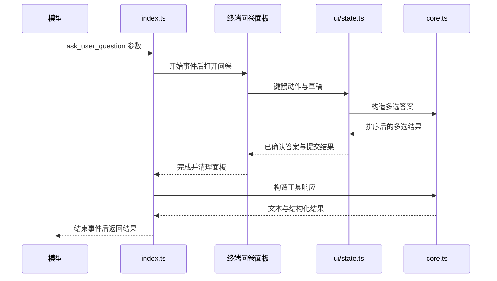

# 架构

入口注册顺序执行的问卷工具，按界面模式选择终端面板或原生对话框。两条路径共用回答契约和结果构造；共享面板负责宿主恢复与清理，详见[共享 UI](../../../shared/docs/ui.md)。

## 模块关系



## 文件地图

| 文件 | 职责 |
|---|---|
| `index.ts` | 配置开关、工具注册、活动工具协调、界面分派、通知与事件转发 |
| `core.ts` | 输入与输出契约、回答构造、原生对话框、工具响应 |
| `events.ts` | 问卷开始与结束事件的名称和载荷 |
| `tui.ts` | 将问卷组件接入共享停靠会话 |
| `ui/component.ts` | 渲染问题与审阅页、输入焦点及鼠标命中 |
| `ui/keys.ts` | 将键盘输入映射为问卷动作 |
| `ui/state.ts` | 草稿、勾选、确认、审阅与取消的状态转换 |

## 数据流



RPC 改由 `core.ts` 逐题收集并在最后一题后返回；取消保留已确认答案，中止和交互错误抛出异常。无界面或交互前已中止的调用在开始事件前结束。

## 约束

- 输入与输出契约、`buildMultiAnswer` 集中于 `core.ts`，两条路径共用索引排序和去重规则，以保留重复标签的独立身份。
- `ui/state.ts` 仅将显式确认写入答案，最后一题进入审阅而非提交，防止草稿或局部回答被当作完整提交。
- 自定义行的 Space 由组件交给输入框，避免 `ui/keys.ts` 的多选动作吞掉文字空格。
- `tui.ts` 将宿主完成与中止清理交给共享会话，组件只保留业务状态，以保证结束后恢复编辑器草稿与焦点。
- `index.ts` 保持工具顺序执行，并在每轮开始前协调活动工具列表，避免无界面时向模型暴露交互工具。
- 问卷事件与面板事件分离，入口只转发真实面板回调，避免订阅方将问卷开始误判为面板已打开。
- `buildResponse` 将取消文本与结构化答案分开处理，防止取消时保留的答案被表述为成功提交。

## 事件契约

`pi.events` 发送 `workflow:ask-user-question:start` 和 `workflow:ask-user-question:end`。前者携带 `toolCallId`、`mode`、`questionCount`；后者追加 `status`：`answered`、`cancelled`、`aborted` 或 `error`，前两种携带 `result`。

终端路径转发共享面板事件，`panelId` 为 `ask-user-question`，`instanceId` 为工具调用 ID；正常顺序为问卷开始、面板打开、面板关闭、问卷结束。共享事件名称与载荷见[面板事件契约](../../../shared/ui/docked-panel/events.ts)。

## 测试

在仓库根目录执行：

```sh
npm test --workspace=pi-ask-user-question
```

| 测试 | 覆盖 |
|---|---|
| `core.test.ts` | 契约、结果、原生对话框、取消、多选、中止 |
| `index.test.ts` | 注册、配置、活动工具、通知、生命周期事件 |
| `tui.test.ts` | 状态、按键、鼠标、审阅、焦点与尺寸变化 |
| `tui-wheel.test.ts` | 宿主停靠、滚轮路由、编辑器恢复与关闭回调 |
