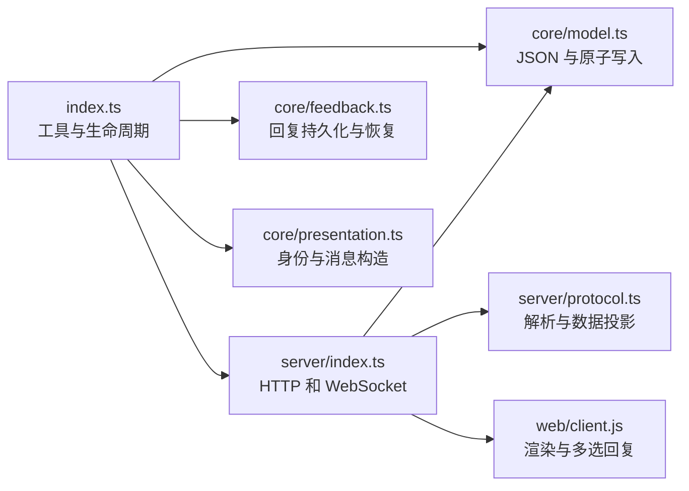
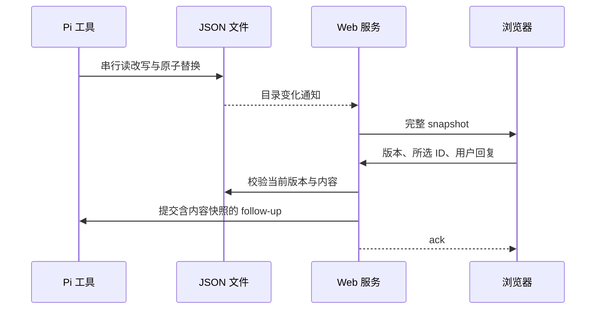

# 架构

插件串行修改 JSON，HTTP 服务提供本地渲染资源，WebSocket 始终同步完整文档；浏览器按稳定 ID 协调更新并回传多选回复。

## 模块关系

## 文件地图

| 文件 | 职责 |
|---|---|
| `index.ts` | 三工具、配置、用户反馈与服务生命周期 |
| `core/model.ts` | TypeBox 契约、完整批次校验、文件读改写 |
| `core/feedback.ts` | 回复先存入会话，交付确认、重载恢复与去重 |
| `core/types.ts` | 核心层与服务层共用的反馈类型 |
| `core/presentation.ts` | 文档身份、提示文本、工具结果与错误消息的纯构造 |
| `server/index.ts` | 静态资源、完整快照、目录监听和反馈确认 |
| `server/protocol.ts` | 消息解析、校验、指纹、反馈快照与错误投影 |
| `web/client.html` | 页面与回复窗口骨架 |
| `web/client.css` | 纸张、选择框、工具栏与弹窗样式 |
| `web/client.js` | 按 ID 渲染、连接恢复、选择与提交 |

## 数据流

初次连接与重连发送完整快照；过期回复拒绝提交并保留浏览器输入。

## 约束

- 消息构造、文档解析、变更计划与浏览器派生视图使用显式输入的纯函数；副作用函数只编排计算结果与持久化、网络、DOM 操作，防止格式化或校验意外改变运行状态。

- 工具成功结果的 `content` 使用固定提示，动态 ID、URL、文档路径与版本放在 `structuredContent` 和 `details`，避免重复序列化到文本。
- `index.ts` 是唯一扩展入口，`core/` 不依赖 `server/` 或 `web/`，跨层反馈类型放在 `core/types.ts`，避免循环依赖。
- 服务从 `web/` 读取静态资源，HTTP 路径保持 `/client.js` 与 `/client.css`，目录调整不得改变浏览器资源协议。

- JSON 固定保存在项目 `docs/canvas-notes/<UTC时间>-<UUID>/doc.json`，时间格式为 `YYYY-MM-DDTHH-mm-ssZ`，完整目录名写入会话条目，确保重载沿用同一文件且不同会话不互相覆盖。
- JSON 是唯一权威状态，服务关闭不删除文件，确保重启后能恢复文档。
- `CANVAS_NOTE_PUBLIC_HOST` 只控制 URL 展示，每次服务启动读取且在绑定端口前校验，避免临时网络地址写入共享配置或无效地址导致监听资源泄漏。
- 未配置 host 时按 SSH 环境选择 `0.0.0.0` 或本地 `localhost`，显式配置始终优先，确保用户能覆盖自动监听策略。
- 端口只在配置区间内分配，遇到占用重试，区间耗尽时报错，避免绑定范围外端口。
- 所有读改写共用 Pi 文件队列，临时文件与目标文件同目录原子替换，避免并发覆盖和半份 JSON。
- 监听目录而不是文件 inode，确保原子替换后持续收到变化。
- 每次同步完整快照，不能只传最后一次变更，否则快速连续写入会漏操作。
- 浏览器保留稳定 ID 的实例，未变化的内容不重绘，避免丢失图表交互状态。
- `spec` 整体替换，换类型时需要新 spec，避免旧格式进入新渲染器。
- 回复校验版本并附带原内容后才确认成功，避免引用更新后内容或丢失失败输入。
- 回复在 ACK 前写入会话，只有消息正式进入上下文才标记交付；被拒绝的 prompt 在下次运行补交，避免确认成功却丢失回复。
- 同一 requestId 的成功回复去重，防止重试重复注入会话。
- 关闭服务等待已接收的回复任务结束，关闭后的任务不得调用旧 Pi runtime。
- 服务只在插入或更新后启动，关闭由网页按钮确认或最后一个连接断开触发，不注册命令，避免创建空页占用端口。
- 最后一个连接断开后等待 1.5 秒，新连接取消关闭；插件串行关闭前再次检查连接数，避免刷新和排队期间的新连接被误关。
- 关闭网页使用 beforeunload 原生确认，pagehide 才断开连接；取消确认不得触发服务关闭。
- 客户端渲染错误每版本每 Block 去重，Pi 自动修复最多三次，避免修复循环。

## 测试

`npm test --workspace canvas-note` 运行 `tests/*.test.ts`，覆盖原子批次、并发写入、真实 HTTP/WebSocket、快照、回复去重、过期反馈、服务重启与工具 handler。`tests/presentation.test.ts`、`tests/protocol.test.ts`、`tests/web.test.ts` 校验纯构造结果与输入不变性；反馈与模型测试同时校验投影阶段不提交状态。复杂公式样例集中在 `tests/fixtures/math.ts`。根测试覆盖实际 Pi 独立加载和生产依赖安装。
