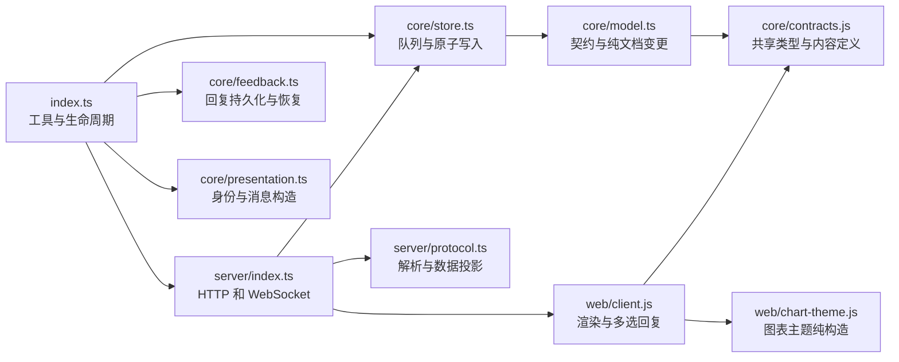
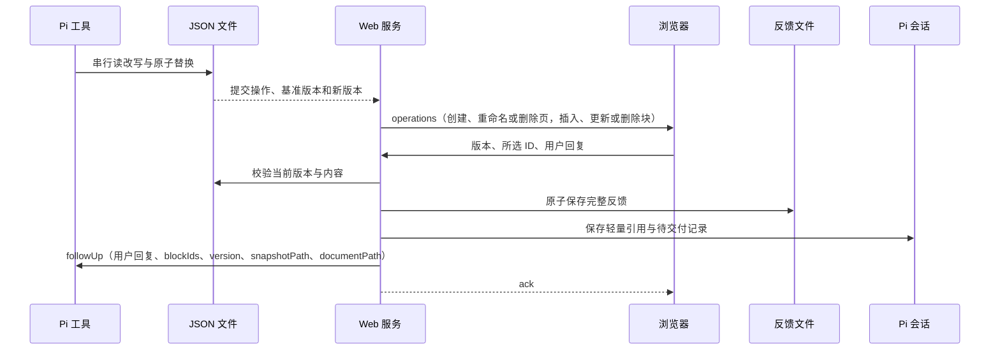

# 架构

插件串行修改 JSON，落盘后记录操作，WebSocket 推送操作增量供浏览器消费；首次连接、重连和外部文件修改使用完整快照恢复。HTTP 服务提供本地渲染资源。

## 模块关系



## 文件地图

| 文件 | 职责 |
|---|---|
| `index.ts` | 四工具、配置、用户反馈与服务生命周期 |
| `core/model.ts` | TypeBox 契约、完整批次校验与纯文档变更 |
| `core/store.ts` | ID 生成、当前页指针、队列读改写、原子落盘与提交订阅 |
| `core/contracts.js` | Block、对齐、操作和消息枚举，内容校验、摘要与注册完整性检查 |
| `core/feedback.ts` | 反馈文件持久化与会话轻量引用，交付确认、重载恢复与去重 |
| `core/types.ts` | 核心层与服务层共用的反馈类型 |
| `core/presentation.ts` | 文档身份、提示文本、工具结果与错误消息的纯构造 |
| `server/index.ts` | 静态资源、操作增量、快照恢复、目录监听和反馈确认 |
| `server/theme.ts` | 从扩展根目录 theme.json 读取配色，校验后生成主题 CSS |
| `server/protocol.ts` | 消息解析、校验、指纹、反馈快照与错误投影 |
| `web/client.html` | 页面、固定目录与回复窗口骨架 |
| `web/favicon.svg` | 浏览器标签图标 |
| `web/content.css` | 屏幕与打印共享的配色变量、字体和正文排版 |
| `web/client.css` | 屏幕专属纸面布局、目录、选择框、工具栏与弹窗样式 |
| `web/print.css` | 纸张、浅色配色、隐藏交互与分页规则 |
| `web/chart-theme.js` | 从页面配色纯构造屏幕与打印图表主题 |
| `web/client.js` | 消费操作、按 ID 渲染、固定 page/block 目录、连接恢复、选择与提交 |
| `web/export-html.js` | 克隆正文、内嵌资源与 ECharts、生成和下载离线单文件 HTML |

## 数据流



首次连接、重连、外部文件修改或客户端请求 `resync` 时发送完整 `snapshot`；过期回复拒绝提交并保留浏览器输入。

## 操作协议

```text
{ type: "operations", documentId, baseVersion, version, operations: [
  { type: "page:create", page: { id, title, blocks: [] }, index },
  { type: "page:update", pageId, change: { kind: "rename", title } },
  { type: "page:update", pageId, change: { kind: "delete" } },
  { type: "blocks:insert", pageId, index, blocks: [完整 Block] },
  { type: "blocks:update", blocks: [完整 Block], removed: [blockId] }
] }
```

一次原子变更对应一个版本和一个操作批次；自动创建页面后插入内容的两个操作属于同一批。更新操作携带完整的新 Block，不传 spec 的局部 patch。客户端预检整批引用和插入位置，按顺序直接修改本地文档与对应 DOM；正常更新不遍历整份文档求差。

## Code Block

`BlockKind.Code = 'code'`，内容为 `{ code: string, language?: string }`；`code` 允许空字符串，`language` 允许省略、空字符串或未知字符串。共享定义校验字段类型，摘要原样返回 `spec.code`。内部 `InsertBlock` 联合 schema 包含 code 分支；工具参数 `InsertBlocksToolParams` 只声明一次 `title`、`align` 公共字段，`anyOf` 分支从内部 schema 派生 `type` 与 `spec`，保持类型与内容的关联，避免开放的图表分支放过其他类型的错误内容。工具执行前继续用 `InsertBlocksParams` 校验；更新仍整体替换 `spec`，换类型必须提供完整的新内容。

```js
{ type: "code", spec: { code: "const answer = 42;", language: "javascript" } }
{ type: "code", spec: { code: "<plain text>", language: "unknown-language" } }
{ type: "code", spec: { code: "" } }
```

浏览器使用随扩展分发的 Highlight.js common build 本地资源。首例显式语言受支持时高亮，后两例以纯文本展示；空语言同样按纯文本处理，不进行自动语言检测。代码采用 Gruvbox 配色，只读展示，不执行代码。

## Markdown 公式

文本渲染通过独立的 Marked 实例接入 `marked-katex-extension`，启用 `nonStandard` 解析紧邻中文的美元符号公式。插件在 KaTeX 之后从本地 UMD 资源加载；公式沿用 `throwOnError: true`、`trust: false`、`strict: "error"`，结果统一经 DOMPurify 清理。Markdown 公式随现有正文 DOM 打印和导出，不增加导出脚本。

## 新增类型

Block 类型在 `core/contracts.js` 的 `BlockKind` 与 `blockDefinitions` 中声明内容校验、摘要；Block 的可选 `title` 是公共元数据，目录优先显示它，没有时回退到 `type`；浏览器在 `web/client.js` 的 `blockHandlers` 中补充渲染。TypeBox 枚举、客户端白名单和业务分派从这些定义派生，不再逐处维护类型列表。

页修改统一使用 `page:update`，`PageChangeKind` 标记 `rename` 与 `delete` 分支；`isPageChange` 在前后端共享严格校验，拒绝多余字段，工具的 TypeBox 联合 schema 同步约束。这样不会把删除携带的标题误当作重命名。

操作类型在 `OperationKind` 声明名称，在 `core/model.ts` 的 `Operation` 联合类型中定义载荷，在 `operationHandlers` 中集中实现预检与消费。通信消息和对齐分别使用 `MessageKind`、`Alignment`，不与 Block 枚举混用。

共享模块使用 JSDoc 类型检查；注册表缺少或多出类型会抛错，测试同时检查每类行为齐全。浏览器以原生 ESM 导入 `/core/contracts.js`，服务只暴露该模块文件，不公开整个核心目录。

## 约束

- 消息构造、文档解析、变更计划与浏览器派生视图使用显式输入的纯函数；副作用函数只编排计算结果与持久化、网络、DOM 操作，防止格式化或校验意外改变运行状态。

- 工具成功结果的 `content` 使用固定提示，动态 ID、URL、文档路径与版本放在 `structuredContent` 和 `details`，避免重复序列化到文本。
- `index.ts` 是唯一扩展入口，`core/` 不依赖 `server/` 或 `web/`，跨层反馈类型放在 `core/types.ts`，避免循环依赖。
- `core/contracts.js` 是前后端共享的类型来源，不访问 DOM 或注册生命周期；Block 的内容校验与摘要只定义一次，浏览器只补充渲染行为，防止新增类型后前后端接受范围不一致。
- Block 与操作注册表都检查枚举覆盖范围，业务只查表分派；新增类型缺少处理器时启动或测试直接失败，避免遗漏业务分支。
- `theme.json` 是随扩展分发的网页配色资源，不是 Pi 设置；`/theme.css` 每次请求重新读取，只将白名单键的十六进制色值转换为 CSS 变量，缺失或无效项沿用基础样式，避免任意 CSS 注入和主题错误阻断文档。
- 服务从 `web/` 读取静态资源，HTTP 路径保持 `/client.js`、`/client.css`、`/content.css` 与 `/print.css`，目录调整不得改变浏览器资源协议。
- 正文样式只在 `content.css` 定义；网页布局与交互限制为 screen，打印只补差异并复用同一 DOM，避免维护两套 Block 渲染器。打印生命周期只通过 ECharts `setTheme`、`resize` 和画布同步刷新适配已有图表，不重建图表或改变文档、选择和目录状态。
- 图表主题默认值从 CSS 变量构造，用户 spec 的显式样式优先；主题不得写回文档或复制结果。屏幕主题在启动时缓存，打印主题在打印前读取，打印结束恢复缓存，避免浏览器结束事件仍处于 print 媒体时错误保留浅色主题。
- Chrome 在 `beforeprint` 后才确定纸张最终宽度，打印样式必须约束 ECharts 首个画布容器及 canvas 的宽高，不调整 tooltip 容器，并保持画布内容纵横比，避免饼图变形或图表溢出覆盖下一个 Block。

- JSON 固定保存在项目 `docs/canvas-notes/<UTC时间>-<UUID>/doc.json`，时间格式为 `YYYY-MM-DDTHH-mm-ssZ`，完整目录名写入会话条目，确保重载沿用同一文件且不同会话不互相覆盖。
- JSON 是唯一权威状态，服务关闭不删除文件，确保重启后能恢复文档。
- `CANVAS_NOTE_PUBLIC_HOST` 只控制 URL 展示，每次服务启动读取且在绑定端口前校验，避免临时网络地址写入共享配置或无效地址导致监听资源泄漏。
- 未配置 host 时按 SSH 环境选择 `0.0.0.0` 或本地 `localhost`，显式配置始终优先，确保用户能覆盖自动监听策略。
- 端口只在配置区间内分配，遇到占用重试，区间耗尽时报错，避免绑定范围外端口。
- `core/model.ts` 的 `insertPage`、`insertBlocks`、`updatePage`、`updateBlocks` 显式接收文档和 ID，返回新文档、操作与结果，不修改输入、不生成随机值或访问文件；`core/store.ts` 在队列内读取最新文档后计算并落盘，防止组合变更时重复提交和并发覆盖。
- 所有读改写共用 Pi 文件队列，临时文件与目标文件同目录原子替换，避免并发覆盖和半份 JSON。
- 监听目录而不是文件 inode，确保原子替换后持续收到外部变化；同一路径的 Store 共享提交订阅，提交操作只在原子替换成功后发布，避免消费未保存内容。
- 提交通知与快照读取在同一文件队列内排入发送队列，并按连接维护文档指纹；文件监听不重复发送已发布提交，外部同版本编辑仍触发完整快照，避免乱序和漏更新。
- 操作仅作内存中的实时通知，不维护持久化事件日志；JSON 是恢复依据，首次连接与重连始终取完整快照。
- 客户端只消费基准版本匹配、版本连续且文档身份一致的操作批次；不匹配时请求一次 `resync`，暂停消费和回复直到完整快照恢复，避免在错误基线上继续更新。
- 浏览器正常路径直接消费 Block 和 Page 操作，不做全量差异比较；完整快照恢复才遍历协调。稳定 ID 保留原 DOM、选择、图表实例和目录条目，删除、更换类型、渲染失败或页面退出时释放图表资源。
- 目录固定在左侧并独立滚动；目录只通过稳定 page/block ID 定位正文，折叠目录不得改变正文状态，避免导航操作干扰文档渲染。
- 渲染错误每版本每 Block 只成功回报一次；重复快照不重复发送，发送失败可在后续快照重试，避免目录监听与显式同步重复触发修复。
- 页修改必须有有效变更，重名、空标题、删除与重命名混用或未知 ID 均不写入、不发布提交，避免无效版本；删除当前页仅在落盘成功后清空指针，下次隐式插入创建新页。
- 页修改仅 flush 已运行服务，不启动或重启监听，避免仅管理页面时占用端口。
- `spec` 整体替换，换类型时需要新 spec，避免旧格式进入新渲染器。
- HTML 导出只克隆正文，不修改在线 DOM 或图表实例；资源全部内嵌，离线脚本只恢复 ECharts，不加载在线客户端，避免导出文件连接服务。图表配置序列化转义 `<`，避免内容提前结束脚本标签。
- 复制内容从当前 Block 数据按类型投影，不读取渲染 DOM，避免混入按钮、高亮标签或旧内容；复制按钮不得改变多选状态，剪贴板回退使用的临时元素在成功或失败后均清理。
- Code 只在显式 `language` 被本地 Highlight.js common build 支持时高亮；省略、空或未知语言保留纯文本，避免猜测语言改变展示。代码只读且不执行，HTML 内容必须作为文字处理，避免代码块触发脚本。
- 回复校验版本并保留所选块的完整快照后才确认成功，避免引用更新后内容或丢失失败输入。
- 完整反馈包含 `requestId`、`version`、`reply` 和含完整快照的 `blocks`，保存为与 `doc.json` 并列的 `feedback-<requestId>.json`；不适合作文件名的 `requestId` 使用其哈希，避免非法路径。文件作为笔记长期保留，交付、重载和关闭服务不得删除，避免丢失用户引用的原内容。
- 交付顺序固定为原子保存反馈文件、在 Pi 会话保存轻量引用、发送 `followUp`；ACK 前完成文件与引用持久化，避免确认成功却丢失回复。
- 正常反馈与待交付恢复上下文均仅包含用户回复、`blockIds`、`version`、`snapshotPath` 和 `documentPath`，不包含块正文；模型按需用 `read` 读取 `snapshotPath`，修改前检查当前 `documentPath`，避免按旧快照覆盖后续更改。
- 会话负责去重、待交付与交付确认；只有消息正式进入上下文才标记交付，被拒绝的 prompt 在下次运行补交。恢复旧会话尚未交付的完整反馈时先迁移为反馈文件与轻量引用，再按轻量上下文补交，避免重新注入块正文。
- 同一 requestId 的成功回复去重，防止重试重复注入会话。
- 关闭服务等待已接收的回复任务结束，关闭后的任务不得调用旧 Pi runtime。
- 服务只在插入或更新后启动，关闭由网页按钮确认或最后一个连接断开触发，不注册命令，避免创建空页占用端口。
- 最后一个连接断开后等待 1.5 秒，新连接取消关闭；插件串行关闭前再次检查连接数，避免刷新和排队期间的新连接被误关。
- 关闭网页使用 beforeunload 原生确认，pagehide 才断开连接；取消确认不得触发服务关闭。
- 客户端渲染错误每版本每 Block 去重，Pi 自动修复最多三次，避免修复循环。

## 测试

`tests/changes.test.ts` 用冻结输入验证纯变更可组合、显式 ID、版本不变和失败时输入不变；`tests/model.test.ts`、`tests/server.test.ts` 继续覆盖 Store 的落盘与同步行为。

`npm test --workspace canvas-note` 运行 `tests/*.test.ts`，覆盖原子批次、并发写入、提交订阅、真实 HTTP/WebSocket、操作增量、快照恢复、回复去重、过期反馈、服务重启与工具 handler。`tests/contracts.test.ts` 校验共享枚举、内容定义与注册完整性，包含 Code 合法/非法内容、原样摘要与输入不变性；`tests/model.test.ts` 校验 TypeBox 联合 schema 覆盖、Code 插入与读取、整体替换、换类型、删除和原子失败；`tests/presentation.test.ts`、`tests/protocol.test.ts`、`tests/web.test.ts` 校验纯构造结果与输入不变性；反馈与模型测试同时校验投影阶段不提交状态。`tests/reconcile.test.ts` 通过 `tests/fixtures/browser.ts` 的最小浏览器环境执行完整客户端脚本，验证局部 DOM 写入、图表生命周期、选择保留和版本恢复。`tests/chart-theme.test.ts` 校验主题纯构造与真实 ECharts 显式样式优先；`tests/print.test.ts` 验证样式分层、字体图片就绪、打印重试与状态保留。`tests/math.test.ts` 使用真实 Marked 和 KaTeX 覆盖 Markdown 行内与展示公式、中文相邻、代码、转义及解析错误；复杂公式样例集中在 `tests/fixtures/math.ts`。`tests/export-html.test.ts` 覆盖导出失败后的控件恢复；检测到 Chromium 时验证资源内嵌、在线 DOM 不变、脚本安全序列化和离线图表恢复。根测试覆盖实际 Pi 独立加载和生产依赖安装。
