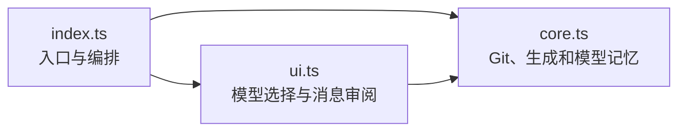
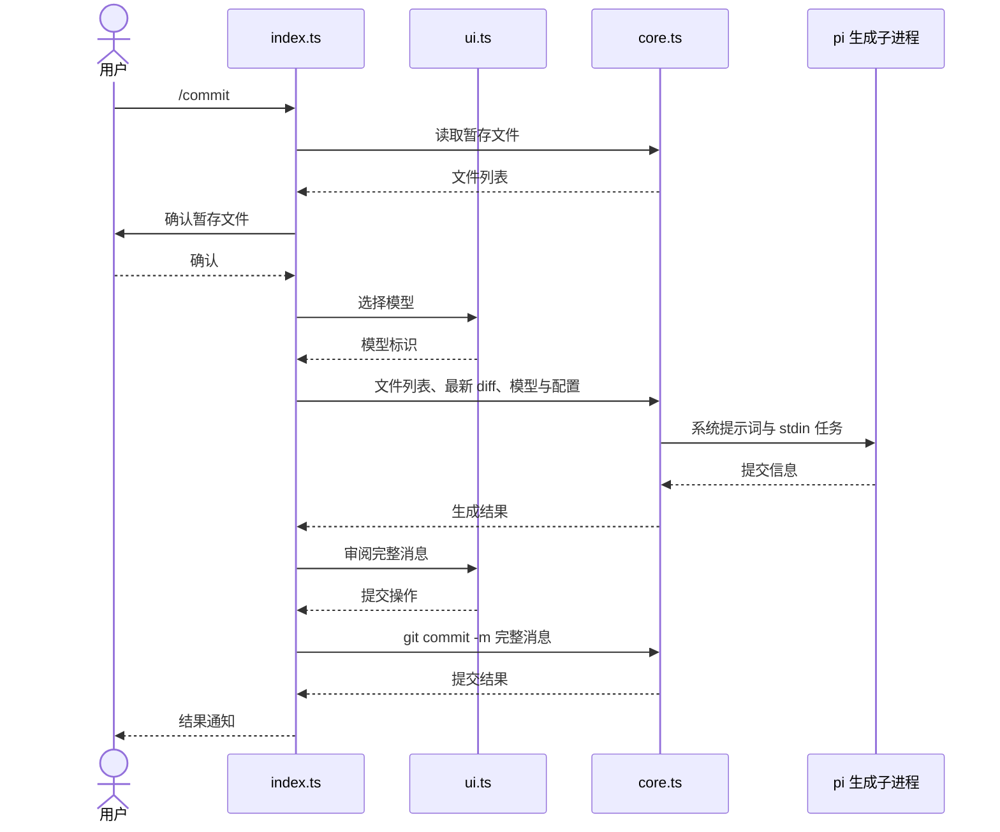

# 架构

入口协调暂存区确认、模型选择、生成和提交；核心逻辑执行 Git 与生成子进程，界面负责交互。共享配置负责校验和原子更新，通知由共享库发送，细节见[共享配置](../../../shared/config/README.md)与[共享库](../../../shared/README.md)。

## 模块关系



## 文件地图

| 文件 | 职责 |
|---|---|
| `index.ts` | 注册命令、启动标志与事件，协调生成、审阅和提交 |
| `core.ts` | 读取暂存区、构造生成任务与参数、执行子进程、清理输出、记忆模型 |
| `ui.ts` | TUI 模糊搜索、消息预览和操作选择；RPC 选择框 |

## 数据流



取消或失败时结束流程；重新生成保留模型并重读 diff；启动标志触发的本次提交成功后退出 Pi。

## 约束

- Git 读取、生成与提交共用 `ctx.cwd`，保证操作作用于同一工作目录。
- `COMMIT_SYSTEM_PROMPT` 集中存放生成规则，`buildTask` 只带文件列表与 diff，避免规则分散后产生分歧。
- `buildPiArgs` 保留工具、扩展、技能、上下文文件和会话的隔离标志，防止生成子进程加载这些资源或写入会话。
- 配置模型或记忆模型缺席注册表时仍加入候选，避免用户配置被静默丢弃。
- 模型记忆只在 `rememberModel` 开启时读写，并通过共享配置更新 `commit.lastModel`，保留其他设置。
- TUI 预览仅显示前 15 行，提交始终使用完整消息，防止展示截断改变提交内容。

## 测试

在仓库根目录执行：

```sh
npm test --workspace=pi-commit
```

- `core.test.ts`：暂存状态解析、Git 往返、任务和参数构造、生成成功/失败/超时、围栏清理、模型排序和记忆读写。
- `index.test.ts`：注册与启动条件、交互前提、模型优先级、记忆开关、配置传递与完成通知开关。
