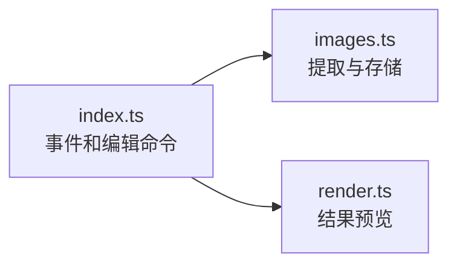
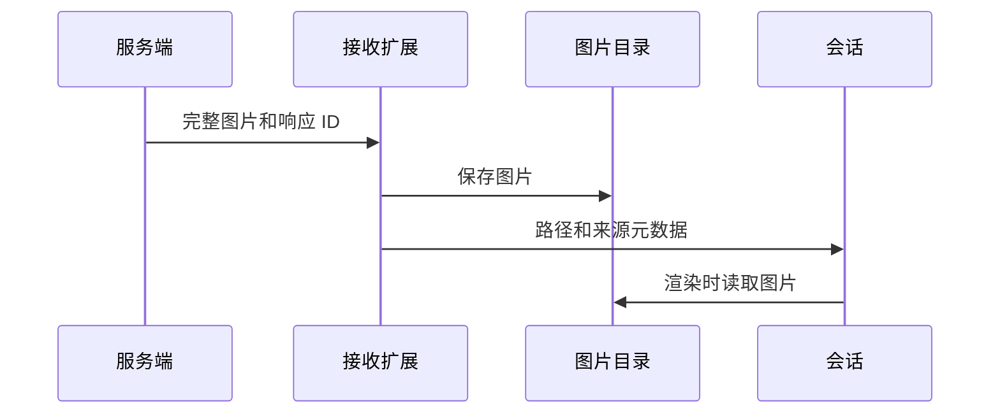

# 架构

`pi-image` 接收 Responses 图片事件并持久化文件，自定义消息保存图片索引。编辑命令只为显式选中的图片设置响应引用。

## 模块关系

## 文件地图

| 文件 | 职责 |
|---|---|
| `index.ts` | 事件注册、当前分支图片检索、编辑请求和生命周期 |
| `images.ts` | 完整图片提取、数据校验、安全文件名和落盘 |
| `render.ts` | 从磁盘加载图片，以 Markdown 和 Image 组件展示 |

## 数据流

图片保存失败生成错误消息；编辑引用失效由原模型请求直接报告错误。

## 约束

- 会话仅保存路径和元数据，避免图片 base64 扩大会话和后续模型上下文。
- 只保存完整图片，按来源和 item ID 去重，避免完成事件重复产生结果。
- 编辑目标从当前分支读取且必须匹配当前模型，避免跨分支或跨提供方引用。
- 待编辑状态在任务结束和会话切换时清理，避免普通对话继承图片引用。
- 编辑失败不回传原图或重新生成，保留服务端错误而不静默改变请求语义。

## 测试

`npm run test --workspace pi-image` 验证接收、文件存储、编辑请求和预览回退；根目录测试验证 manifest 和隔离加载。
