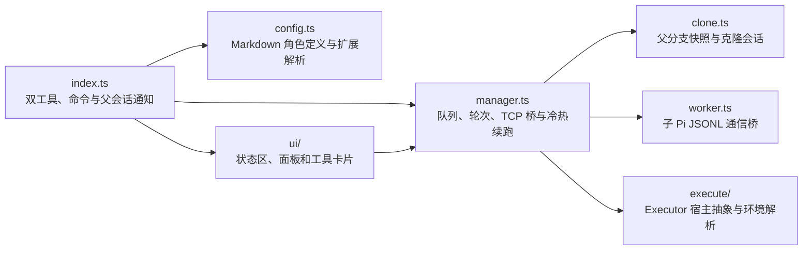
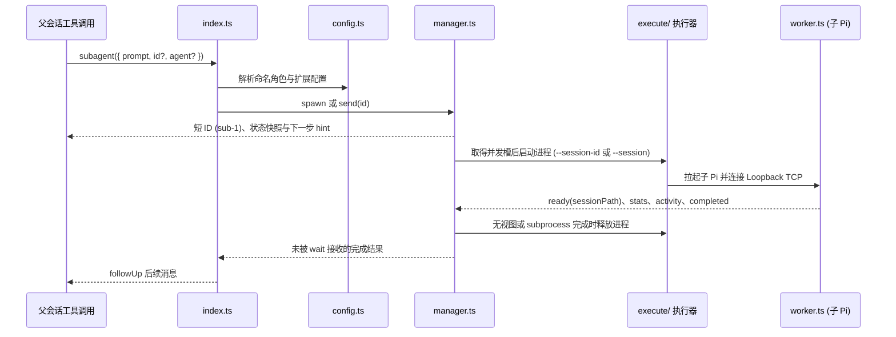

# 架构

`pi-subagent` 采用 **Config（配置与角色解析）** 与 **Execute（宿主执行器抽象）** 两层架构。入口注册 `subagent`（派发、引导、续跑合一）与 `subagent_ctl`（等待、状态、停止合一）两个工具；管理器拥有 ECS 数据驱动状态调和循环、短 ID 分配、Loopback TCP JSONL 通信桥与按 `sessionPath` 冷热恢复的生命周期；执行器抽象统一封装 `herdr-core` 与后台 `subprocess`。

## 模块关系



## 文件地图

以下路径相对扩展目录；仅列源码。

| 文件 | 职责 |
|---|---|
| `index.ts` | 启用条件、`subagent` 与 `subagent_ctl` 工具、`/subagent:views` 命令、退出清理 |
| `config.ts` | Markdown 角色定义发现、扁平 Frontmatter 校验、工具描述注入与扩展源解析 |
| `manager.ts` | 短 ID、FIFO 队列、Loopback TCP 服务端、Steer/热 Resume/冷 Resume 路由、下一步 `hint` 与资源释放 |
| `worker.ts` | 子 Pi 进程通信桥扩展、JSONL 命令接收、`agent_settled` 批次完成边界与原生交互上报 |
| `clone.ts` | 父分支快照冻结与隐藏未决工具调用的独立会话克隆 |
| `util.ts` | 异步操作串行链与 UTF-8 字节截断 |
| `execute/index.ts` | `Executor`、`TerminalHandle`、`ViewHandle`、`ExecutorError`、环境变量合成与句柄表契约 |
| `execute/resolve.ts` | 按显式优先级选择 `herdr-core` 或兜底 `subprocess` |
| `execute/herdr-core.ts` | Herdr Core（`hc` JSON-RPC）终端管理与基于标签的标签页视图 |
| `execute/subprocess.ts` | 无头 Node 子进程与 POSIX 进程组清理执行器 |
| `ui/presentation.ts`、`ui/renderers.ts` | 统一身份标题、统计、工具卡片和通知展示 |
| `ui/status-widget.ts`、`ui/views.ts` | 编辑器上方状态区、点击打开视图和 `/subagent:views` 面板 |

## 数据流



传入已有 `id` 调用 `subagent` 时：若当前轮正在运行则通过在线连接直接发送 `steer`；若上一轮已结束且终端仍在线则热发新一轮 `task`；若进程已释放则使用保存的 `sessionPath`（`pi --session <sessionPath>`）重新入队冷启动恢复完整上下文。

## 约束

- 两个工具 `subagent` 与 `subagent_ctl` 共享 `pi-subagent` namespace 元数据，保持 Codemode 分组与发现入口一致。
- `index.ts` 在 `PI_KITS_SUBAGENT_WORKER === "1"` 时直接返回；子 Pi 显式通过 `--no-extensions -e worker.ts` 启动，防止子会话递归注册协调工具。
- `execute/resolve.ts` 优先匹配非空 `HC_TERMINAL_ID`（`herdr-core`），其余环境一律回退到 `subprocess`，保证扩展在任意终端或无头环境下可用。
- `config.ts` 将角色配置拍平在 YAML Frontmatter 顶层（`model`、`thinking`、`prompt_mode`、`inherit_context`、`tools`、`disallowed_tools`、`extensions`），项目同名文件整体覆盖全局文件；角色查找始终基于父工作目录。
- `subagent` 工具通过 `prepareLoadout` 动态将当前工作目录下已启用的角色及说明附加到工具描述中，省去独立的角色列举工具调用。
- 任务 ID 使用会话内递增短标识（`sub-1`、`sub-2`），底层 Pi 会话使用唯一 UUID（`subagent-<uuid>`）隔离磁盘文件，防止 LLM 复制长 UUID 出错或跨会话冲突。
- 每次快照投影通过 `buildNextHint` 生成与当前状态匹配的下一步调用提示（`hint`），引导 LLM 正确使用 `subagent` 与 `subagent_ctl`。
- 无视图执行器（`subprocess`）在单轮任务结束时自动销毁子进程释放内存，仅保留 `sessionPath`；后续 `send` 调用在检测到连接已关闭时自动以 `--session <sessionPath>` 重新拉起子进程接续历史。
- `clone.ts` 在入队前同步冻结父分支快照，并在克隆会话的上下文投影中隐藏未决工具调用，防止修改父会话或伪造工具结果。
- `worker.ts` 以 `agent_settled` 作为整批完成边界，父控制连接断开或协议越界时立即中止并退出，防止孤立子进程残留。
- 包扩展资源名从 `extensionResources` 读取并限于启用的 Pi 清单路径，防止路径越界加载扩展。

## 测试

在仓库根目录执行：

```sh
npm test --workspace=pi-subagent
```

| 测试文件 | 覆盖模块和行为 |
|---|---|
| `config.test.ts`、`clone.test.ts` | 扁平 Frontmatter 解析、同名覆盖、角色描述注入、扩展资源解析与父分支克隆 |
| `index.test.ts` | 注册条件、双工具参数路由、目录校验、通知与命令 |
| `manager.test.ts`、`lifecycle.test.ts` | 短 ID、`hint`、队列、热 Steer、热 Resume、按 `sessionPath` 冷启动 Resume、并发槽与清理重试 |
| `worker.test.ts` | JSONL 帧边界、认证、批次完成、Steer、取消与原生交互上报 |
| `execute/resolve.test.ts`、`execute/subprocess.test.ts` | 环境优先级、进程组后台执行器回退与销毁清理 |
| `execute/herdr-core.test.ts` | Herdr Core 终端所有权、标签页请求、标签状态检查与关闭清理 |
| `ui/components.test.ts`、`ui/renderers.test.ts`、`ui/status-widget-click.test.ts` | 状态区、视图面板、工具卡片展示和鼠标行为 |

## 相关文档

- [配置及校验 schema](configuration.md)
- [共享配置](../../../shared/config/README.md)
- [共享 UI](../../../shared/README.md)
