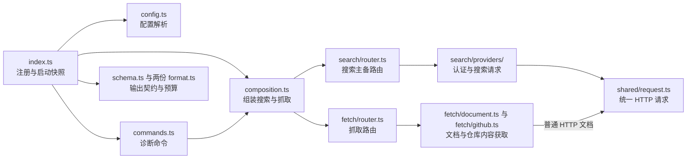
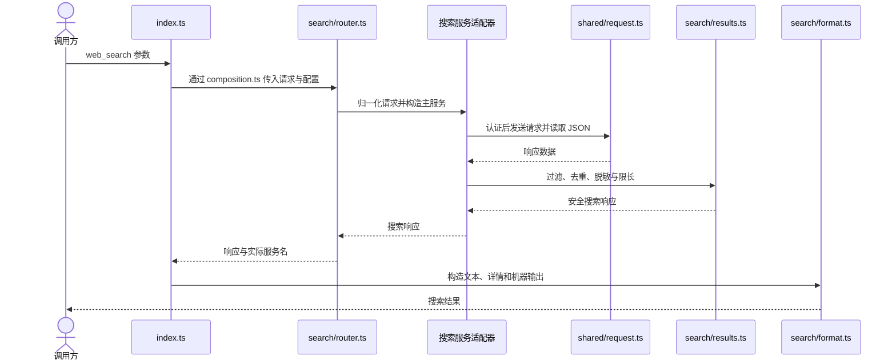
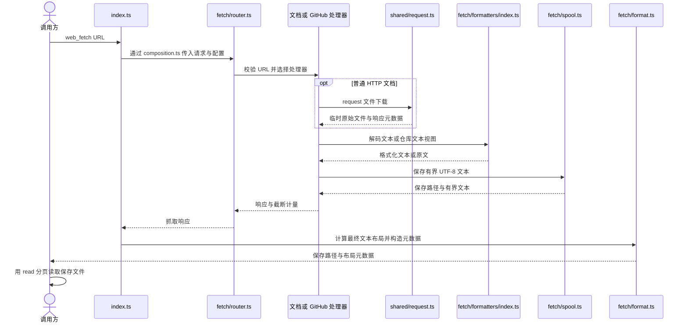

# 架构

[index.ts](../index.ts) 读取启动配置快照并注册工具与诊断命令，[composition.ts](../composition.ts) 按需组装搜索服务和抓取路由；搜索与抓取各自处理认证、超时及错误分类。共享配置与 UI（界面）能力分别见[配置服务](../../../shared/config/README.md)和[共享 UI](../../../shared/docs/ui.md)。

## 模块关系



## 文件地图

| 文件 | 职责 |
|---|---|
| `index.ts` | 工具注册、参数 schema（结构契约）、启动快照、进度及错误边界 |
| `commands.ts` | 状态展示、搜索服务连接测试及参数补全 |
| `composition.ts` | 具体搜索服务工厂与抓取入口组装 |
| `config.ts` | 扩展配置读取、服务名归一化、搜索与抓取配置解析 |
| `schema.ts` | 公开机器输出及派生类型 |
| `search/format.ts`、`renderers.ts` | 搜索文本／机器输出与工具界面渲染 |
| `search/types.ts`、`search/validation.ts` | 搜索内部契约及请求归一化 |
| `search/router.ts`、`search/routing.ts`、`search/errors.ts` | 主备搜索路由、回退选择与分类错误 |
| `search/providers/searxng/config.ts`、`search/providers/searxng/provider.ts` | SearXNG 地址、认证和搜索请求转换 |
| `search/providers/codex/config.ts`、`search/providers/codex/auth.ts`、`search/providers/codex/provider.ts` | Codex 模型配置、Pi 认证及搜索请求转换 |
| `shared/request.ts` | 原生 fetch 的统一入口，负责截止时间、取消、重定向、有界 JSON 读取与文件下载 |
| `search/results.ts` | 搜索结果过滤、去重和脱敏 |
| `shared/url.ts`、`shared/limits.ts` | 搜索与抓取共用的 URL 脱敏规则和资源边界 |
| `fetch/router.ts`、`fetch/types.ts` | 抓取请求解析、处理器选择及运行时能力 |
| `fetch/document.ts`、`fetch/content.ts` | 文档下载编排、解码和标题提取 |
| `fetch/formatters/index.ts`、`fetch/formatters/prettier-worker.mjs` | 按 MIME（媒体类型）／文件名选择格式化器及独立工作线程 |
| `fetch/github-url.ts`、`fetch/github-refs.ts` | GitHub URL 和引用／路径边界解析 |
| `fetch/github.ts` | 只读 API 编排与仓库内容生成 |
| `fetch/gh-client.ts`、`fetch/command.ts` | GitHub 命令参数与有界子进程执行 |
| `fetch/spool.ts`、`fetch/format.ts`、`fetch/errors.ts` | 临时存储、公开元数据与抓取分类错误 |

## 数据流

### 搜索



符合分类策略的失败按配置尝试备用服务；取消结束调用，空结果直接返回。

### 抓取



仅未匹配或关闭 GitHub 专用路由时使用原生 HTTP；已匹配请求的失败直接报错，根 README 的 404 除外。HTTP 原始响应先流式写入临时文件，保存文本后移除中间文件；失败清理临时文件。

## 约束

- `web_search` 与 `web_fetch` 共享 `web-kits` namespace，保持 Codemode 分组与发现入口一致；工具名称与默认 direct 暴露保持不变；主备搜索服务只由配置决定，工具参数仅描述搜索需求，避免模型覆盖路由策略。
- `index.ts` 将同一文件与环境快照交给工具和诊断命令，保持状态展示与实际请求一致；`index.test.ts` 和 `commands.test.ts` 检查启动后读取次数。
- `composition.ts` 负责具体服务组装，`search/router.ts` 仅调用工厂与路由，保证未使用的服务不会触发认证或配置检查；`composition.test.ts` 覆盖惰性构造与凭据隔离。
- 搜索路由保留服务返回的脱敏查询，防止原始输入覆盖清理结果；`search/router.test.ts` 检查返回查询，`composition.test.ts` 检查回退中的凭据反射。
- 搜索回退使用 `search/errors.ts` 的分类策略并在尝试间检查取消信号，避免无效请求或用户取消继续调用备用服务；`search/router.test.ts` 覆盖这些分支。
- Codex 从 Pi 认证接口获取 OAuth 凭据并使用固定搜索端点，避免把其他来源的请求地址和头部混入请求；`search/providers/codex/auth.test.ts` 和 `composition.test.ts` 检查此边界。
- 搜索业务集中在 `search/`，抓取业务集中在 `fetch/`；共用 URL 脱敏规则留在 `shared/url.ts`，避免两个业务目录互相依赖。
- HTTP 请求统一使用 `shared/request.ts`，传输错误由搜索／抓取边界映射为业务分类，避免通用请求依赖业务策略。
- 搜索传输的单次截止时间覆盖认证、请求与响应流，且重定向采用报错策略，避免认证结束过晚仍发请求或重定向转发凭据；`shared/request.test.ts`、Codex 服务测试与 SearXNG 重定向测试覆盖该行为。
- `schema.ts` 统一用 TypeBox 构造公开输出并派生类型，字符串枚举显式声明 `type: "string"`，注册处引用同一输出契约，防止机器字段与类型分歧；`schema.test.ts` 检查枚举和类型推导，`index.test.ts` 检查工具返回值。
- 两个输出格式器以完整序列化返回值计算预算，计入文本、详情和机器数据副本，避免单份内容合规而总返回值超限；边界见 `shared/limits.ts`，测试见两份 `format.test.ts`。
- 抓取格式器仅公开保存元数据，布局基于最终文本计算，使 `read` 的偏移与返回行数一致；`fetch/format.test.ts` 和 `fetch/read-integration.test.ts` 覆盖空行、UTF-8 与分页。
- 格式化在线程中使用固定选项和资源预算，失败返回输入；调用方在保存前检查取消，避免阻塞主线程或将已取消请求当作成功保存；实现见 `fetch/formatters/`、`fetch/document.ts` 与 `fetch/github.ts`。
- `fetch/spool.ts` 串行写入并在写前预留容量，最终化后拒绝重复保存，保证并发写入与短写处理仍满足存储边界；`fetch/spool.test.ts` 覆盖状态和容量竞争。
- GitHub 引用解析只接受唯一分支／标签划分，避免把含 `/` 的引用误当目录；`fetch/github-refs.test.ts` 和 `fetch/github-url.test.ts` 覆盖歧义与显式编码。
- GitHub 处理器无状态且不使用处理器缓存，直接调用 `gh api`，不进行 `--version` 探测或自动克隆；根仅获取描述、默认分支和 README，目录通过 contents API 非递归读取，避免隐式仓库副本及多余请求。
- `fetch/gh-client.ts` 固定 GitHub 主机并以参数数组调用 `gh api`，`fetch/command.ts` 关闭 shell，避免命令解析改变主机或参数含义；相关客户端与进程测试覆盖参数和终止流程。
- 工具与诊断边界重建分类错误消息，避免上游正文、凭据和原始子进程诊断进入返回值；依据见两份 `errors.ts` 及 `commands.test.ts`、`index.test.ts`。

## 测试

在仓库根目录运行[包脚本](../package.json)：

```sh
npm test --workspace=pi-web-kits
npm run typecheck --workspace=pi-web-kits
```

| 测试文件（相对扩展目录） | 覆盖模块 |
|---|---|
| `index.test.ts`、`commands.test.ts`、`composition.test.ts`、`config.test.ts` | 工具注册、启动快照、开关、参数、命令、服务组装与配置 |
| `search/format.test.ts`、`fetch/format.test.ts` | 文本／机器契约、脱敏、布局与完整输出预算 |
| `search/{errors,router,routing,validation}.test.ts` | 搜索分类、回退、取消和归一化 |
| `shared/{request,url}.test.ts`、`search/results.test.ts` | HTTP JSON／文件流边界、截止时间、取消、重定向、清理、过滤和脱敏 |
| `search/providers/codex/{auth,provider}.test.ts` | OAuth、固定端点、请求结构与取消 |
| `search/providers/searxng/{provider,redirect}.test.ts` | 地址配置、搜索参数及真实 HTTP 重定向 |
| `fetch/{command,content,document,errors,router,spool}.test.ts` | 进程、解码、抓取分类、传输、处理器隔离及存储状态 |
| `fetch/formatters.test.ts`、`fetch/github-formatters.test.ts` | 格式选择、工作线程、取消与 GitHub 保存视图 |
| `fetch/github.test.ts` | 只读 API、取消与错误映射 |
| `fetch/{gh-client,github-readme,github-refs,github-url}.test.ts` | 命令、README 边界及引用解析 |
| `fetch/read-integration.test.ts` | 本地 HTTP 与 Pi `read` 的实际分页；`PI_KITS_LIVE_FETCH=1` 启用外网用例 |
| `fetch/model-read.test.ts` | `PI_KITS_MODEL_READ=1` 启用真实模型会话，检查完整审查与定点查询 |

手动模型实验的夹具、参数和报告见[实验方法](notes/2026-10-07-read-ab-test.md)。
