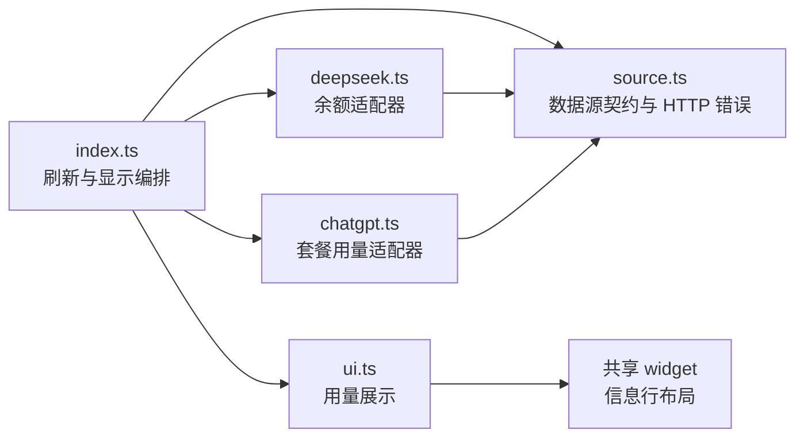
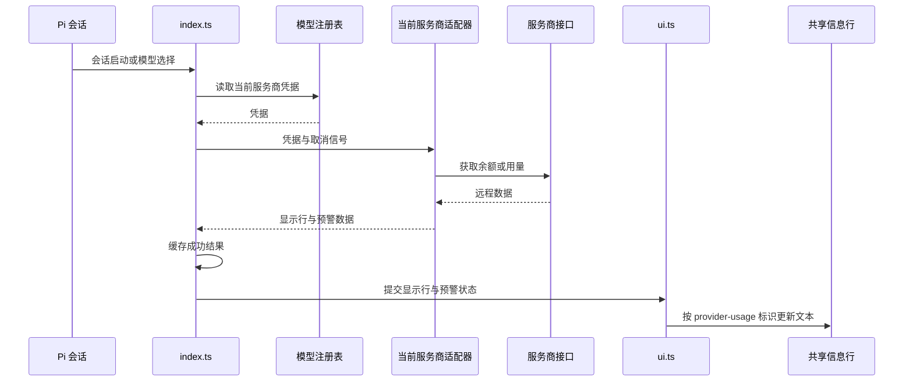

# 架构

入口按主会话模型选择单个数据源，协调认证、轮询、缓存和组件显示。适配器负责远程请求及展示数据转换；配置在加载时通过[共享配置](../../../shared/config/README.md)读取。

## 模块关系



## 文件地图

| 文件 | 职责 |
|---|---|
| `index.ts` | 注册命令和事件，协调认证、刷新、缓存及显示 |
| `source.ts` | 数据源契约、HTTP 错误 |
| `ui.ts` | 按扩展标识更新和清除用量文本，传递预警颜色 |
| `deepseek.ts` | DeepSeek 余额请求、币种展示与预警 |
| `chatgpt.ts` | ChatGPT 认证头、窗口标签、倒计时与预警 |

## 数据流



定时器和 `/usage` 复用刷新流程，后者额外通知当前显示行；无凭据时隐藏组件并停止轮询，失败使用旧缓存或带错误简因的占位行。

## 约束

- 数据源服务商标识同时用于模型匹配、凭据读取与缓存索引，三者保持一致以免凭据送往错误端点。
- 每次刷新在等待认证前固定数据源与注册表身份、递增代次并取消前次请求；异步返回后检查身份和代次，防止切换或关闭后的旧凭据发起请求、旧结果覆盖当前组件。
- 适配器传递调用方的取消信号，并以 `HttpError` 携带状态码，使入口的超时取消和认证恢复分支保持有效。
- 缓存只保存成功数据，空数据和失败展示不覆盖缓存，以便后续失败仍能展示最近成功结果。
- 组件颜色和手动刷新通知级别使用同一适配器预警判定，避免两种反馈不一致。
- 认证恢复文案由适配器提供，入口只在对应 HTTP 401 分支清除缓存并展示，避免 DeepSeek 错误出现 ChatGPT 登录提示。
- 请求超时从获取凭据后开始计时，避免把异步认证等待误计为远程请求超时。
- UI 更新接口以字符串接收内容，空串清除本扩展内容，预警颜色单独传递；位置与完整布局由共享 UI 决定，避免扩展之间产生布局耦合。

## 测试

在仓库根目录执行：

```sh
npm test --workspace=pi-provider-usage
```

| 测试 | 覆盖 |
|---|---|
| `index.test.ts` | 注册、切换、通知、缓存、认证竞态、轮询、关闭与配置时长 |
| `source.test.ts` | 两种适配器的凭据、HTTP 错误、空数据、取消信号与预警 |
| `chatgpt.test.ts` | 多窗口、双单位倒计时和账号认证头 |
