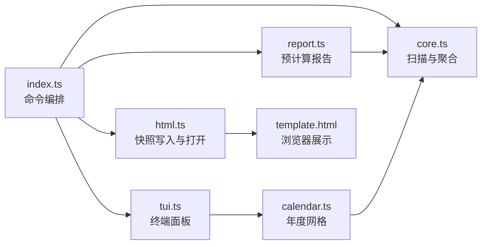
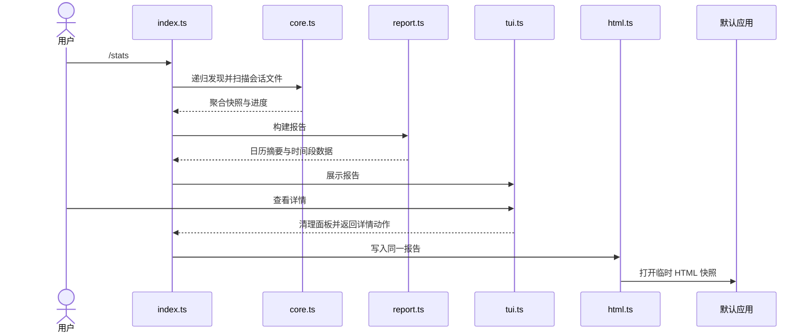

# 架构

入口扫描本地会话后一次构建报告，终端面板和 HTML 共用该报告。终端停靠与默认应用启动使用[共享库](../../../shared/README.md)，配置使用[共享配置](../../../shared/config/README.md)。

## 模块关系



## 文件地图

| 文件 | 职责 |
|---|---|
| `index.ts` | 命令注册、扫描范围、进度和展示编排 |
| `core.ts` | 会话文件发现、逐行扫描、去重和聚合 |
| `report.ts` | 日历摘要、逐日统计及滚动时间段报告 |
| `calendar.ts` | 年度网格、日期用量与热力等级 |
| `tui.ts` | 面板交互、年度缓存、布局和命中区域 |
| `html.ts` | 模板注入、临时快照写入和打开 |
| `template.html` | 浏览器摘要、模型过滤、条形图和每日热力图 |

## 数据流



RPC 跳过终端面板直接打开 HTML；取消面板结束流程，扫描、面板或打开失败由入口通知错误。

## 约束

- 多文件扫描共用去重集合，以记录身份和用量内容共同判重，避免分叉历史重复累计，同时保留同 ID 的不同贡献。
- 日期键、报告的今日与本月及年度网格都使用本地日期，年度遍历从本地正午开始，避免日期边界与夏令时转换错位。
- 日期无效的用量仍进入累计和模型统计，仅有效时间戳进入日期与时间段索引，避免日期解析失败丢失累计贡献。
- TUI 和 HTML 使用同一次构建的报告，HTML 渲染不重算快照，保证两种展示属于同一次统计。
- 年度网格按年份缓存，普通重绘只读取缓存，避免每次按键或窗口变化重新计算全年用量。
- 面板失效、重绘和结束时清除旧命中区域，每次绘制重新读取主题，避免缩放后点击旧位置或保留旧主题颜色。
- 详情动作先结束面板，再由入口打开 HTML，保证共享面板清理后恢复编辑器。
- `html.ts` 与模板保持数据占位符一致，注入前转义 JSON 中的 HTML 特殊字符及行分隔符，防止数据提前结束嵌入脚本。
- 模板与核心保持全部模型标识 `__all__` 一致，模板读取报告中的模型、逐日与时间段字段，以维持过滤结果与聚合结果一致。

## 测试

在仓库根目录执行：

```sh
npm test --workspace=pi-stats
```

| 测试 | 覆盖 |
|---|---|
| `core.test.ts` | 模型与日期聚合、响应模型优先、去重、时间范围、扫描与进度 |
| `report.test.ts` | 本地日期摘要、空报告、HTML 读取预计算报告且不修改报告 |
| `tui.test.ts` | 年度网格、闰日、尺寸、颜色、键鼠交互、缓存与清理 |
| `html.test.ts` | 序列化、时间段统计、独立 HTML、临时文件与打开失败 |
| `index.test.ts` | 取消流程、面板失败、交互前提与配置开关 |
