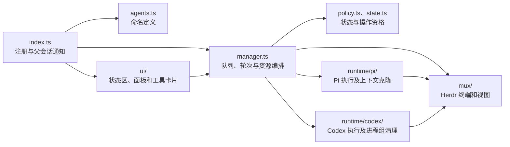
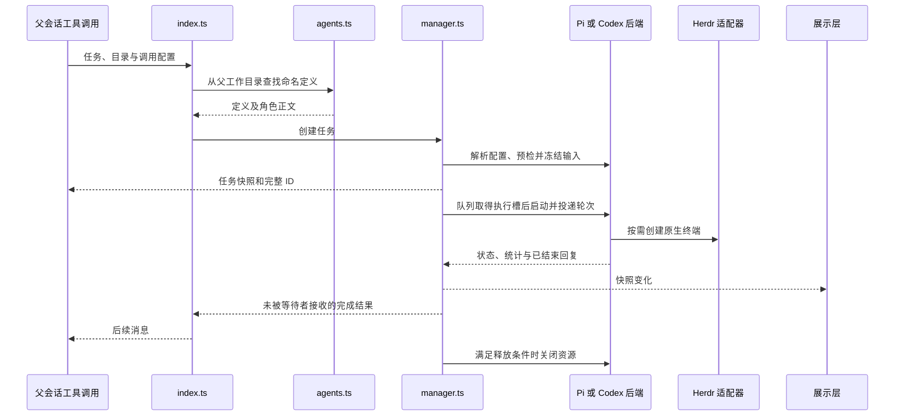

# 架构

入口解析工具调用和 Agent 定义，管理器拥有队列、受管轮次与视图布局，后端拥有执行资源和原生会话，Herdr 适配器拥有终端及视图句柄。展示层订阅快照；共享配置负责校验及默认化，共享 UI 提供面板、树和渲染组件。

## 模块关系



后端通过 `runtime/index.ts` 的接口向管理器发布统一事件，管理器与展示层共用状态策略。

## 文件地图

以下路径相对扩展目录；仅列源码。

| 文件 | 职责 |
|---|---|
| `index.ts` | 启用条件、工具与命令、父会话通知、退出清理 |
| `agents.ts` | Markdown 定义发现、同名覆盖、通用元数据解析 |
| `manager.ts` | FIFO 队列、轮次、等待者、结果、视图布局与资源释放 |
| `state.ts`、`policy.ts` | 独立状态轴、操作资格与展示提示 |
| `runtime/index.ts`、`runtime/errors.ts` | 后端契约、统一事件、投递前拒绝错误 |
| `runtime/pi/config.ts` | Pi 会话配置分区及任务解析 |
| `runtime/pi/index.ts` | Pi 启动、认证 loopback TCP、终端资源与提示词文件 |
| `runtime/pi/worker.ts`、`runtime/pi/protocol.ts` | 子 Pi 通信桥、JSONL 命令与批次结束边界 |
| `runtime/pi/clone.ts` | 父分支快照和独立会话克隆 |
| `runtime/pi/extensions.ts` | 扩展源解析和包声明资源选择 |
| `runtime/codex/config.ts`、`runtime/codex/schema.ts` | 会话开关、每轮审阅目标和工具参数结构 |
| `runtime/codex/index.ts` | 私有 app-server、线程控制、事件转换与回复补读 |
| `runtime/codex/transport.ts` | Bearer 认证 WebSocket JSON-RPC、请求边界和服务端请求处理 |
| `runtime/codex/guardian.ts`、`runtime/codex/guardian.mjs` | POSIX 进程组、父进程 IPC 与后端清理 |
| `mux/index.ts`、`mux/herdr.ts` | 终端和视图接口、Herdr CLI、资源身份核对 |
| `ui/presentation.ts`、`ui/renderers.ts` | 统一身份标题、统计、工具结果和通知展示 |
| `ui/status-widget.ts`、`ui/views.ts` | 状态刷新、点击和视图面板 |

## 数据流



前台调用等待所属轮次；续跑复用后端并进入同一队列；原生交互更新只加入父上下文；投递前拒绝结束本轮，连接或投递结果不明时进入清理路径。

## 约束

- `index.ts` 在 worker 标记为 `1` 时直接返回；Pi 后端显式加载通信桥，防止子 Pi 递归注册父协调工具。
- `agents.ts` 只解析通用字段，保留原始 `runtime_config`；后端划分会话键和每轮键，防止通用层误解释另一后端的选项。
- 管理器在创建资源前完成配置、任务和大小预检；任务解析在验收与发送时保持幂等，防止自定义审阅要求重复追加。
- 绝对 `cwd` 沿入口、管理器、后端和终端传递，Agent 查找仍取父目录，防止任务目录切换改变定义来源。
- `status` 与 `sessionState` 独立，操作资格读取实际完成、连接和清理事实，防止展示提示被当作投递许可。
- 续跑复用后端，异步存活检查后再次检查连接及空闲状态，防止排队期间开始的原生交互被接管。
- 第二轮起按 `round` 过滤旧任务事件，等待者绑定原轮次，防止旧完成、取消或发送失败修改新轮次。
- 结果发布按交互序号过滤，空回复保留已有结果；Codex 补读后复查身份并在发布后报告空闲，防止旧回复覆盖新回复或资源提前释放。
- `RuntimeTaskRejectedError` 只表示原生任务未受触碰的投递前拒绝；发送结果不明使用普通错误路径，防止保留仍执行任务的失联后端。
- 管理器在启动前记录后端所有权，清理确认成功后才丢弃句柄；清理失败保留重试责任及必要的执行槽，防止资源泄漏和超额执行。
- 自动释放在串行操作中及视图探测后重查轮次和资格，防止旧检查关闭已续跑或正在原生交互的会话。
- 管理器串行决定视图布局，附着、探测和打开后重查权限，回滚只关闭本次新建视图，防止影响已有视图和其他任务。
- Herdr 句柄仅属于创建它的适配器实例，销毁前核对窗格、终端、工作区及停止结果；部分启动失败交回清理句柄，防止误关外部终端或丢失所有权。
- Pi 入队前冻结父分支，只在克隆的上下文投影中隐藏未完成工具调用，保留原始历史，防止修改父会话或伪造工具结果。
- Pi worker 以 `agent_settled` 作为整批完成边界，父连接或协议失败触发关闭，防止重试中间结果被当作完成或孤立 worker 继续执行。
- Codex 后端、原生终端和认证目录归同一会话拥有，guardian 关闭等待退出确认，防止终端脱离或父进程退出遗留执行资源。
- 包资源名从 `extensionResources` 读取并限于启用的 Pi 清单路径，防止名称猜测或路径越界加载扩展。
- 展示组件销毁时退订并停表，展示和通知回调失败不改执行结果，防止 UI 故障中断任务或遗留刷新资源。

## 测试

在仓库根目录执行：

```sh
npm test --workspace=pi-subagent
```

| 测试文件 | 覆盖模块和行为 |
|---|---|
| `agents.test.ts`、`runtime-config.test.ts` | 定义覆盖、通用元数据、后端选项分发 |
| `index.test.ts` | 注册条件、工具参数、目录、通知与命令 |
| `manager.test.ts`、`manager-runtime.test.ts`、`lifecycle.test.ts` | 队列、轮次、等待、结果、视图、释放、竞态与清理重试 |
| `policy.test.ts` | 状态组合、操作资格与展示提示 |
| `mux/herdr.test.ts` | CLI 边界、布局、身份核对、回滚与停止确认 |
| `runtime/pi/config.test.ts`、`runtime/pi/index.test.ts`、`runtime/pi/extensions.test.ts` | 配置、启动参数与扩展资源解析 |
| `runtime/pi/clone.test.ts`、`runtime/pi/inheritance.test.ts`、`runtime/pi/worker.test.ts` | 快照、上下文投影、协议、批次、原生交互 |
| `runtime/codex/config.test.ts`、`runtime/codex/call-config.test.ts`、`runtime/codex/schema.test.ts` | 开关、每轮审阅目标和参数结构 |
| `runtime/codex/index.test.ts`、`runtime/codex/transport.test.ts`、`runtime/codex/guardian.test.ts` | RPC、补读、认证、轮次、终端和进程组清理 |
| `ui/components.test.ts`、`ui/renderers.test.ts`、`ui/status-widget-click.test.ts` | 状态区、面板、结果展示和鼠标行为 |

`tests/herdr-live.ts` 需要显式启用，会调用真实模型并创建 Herdr 资源；其环境变量 `PI_KITS_CODEX_BIN` 可指定 `<Codex可执行文件绝对路径>`：

```sh
PI_KITS_HERDR_LIVE=1 npm run test:herdr --workspace=pi-subagent
```

## 相关文档

- [配置及校验 schema](configuration.md)
- [共享配置](../../../shared/config/README.md)
- [共享 UI](../../../shared/README.md)
