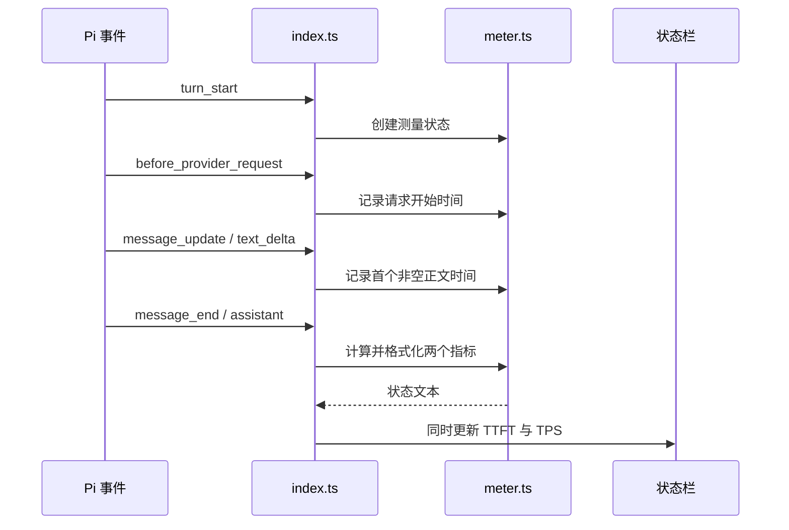

# 架构

扩展监听 Pi 的模型请求与消息事件，记录请求边界和首段正文时间，在每次模型响应结束后更新状态栏。入口负责事件和界面，计算模块通过纯函数返回新状态与指标。

## 文件地图

| 文件 | 职责 |
| --- | --- |
| `index.ts` | 监听事件、读取单调时钟、管理当前测量和更新状态栏 |
| `meter.ts` | 转换测量状态、分别计算 TTFT 与 TPS、格式化显示 |

## 数据流



工具调用与生成期间保留上次结果；失败、取消或延迟响应的 TPS 显示 `—`，已观测到的 TTFT 保留。

## 计算口径

- `calculateTtft()` 返回首个非空正文时间减去请求开始时间，单位为毫秒；缺少时间或差值无效时返回 `undefined`。
- `calculateTps()` 使用 `usage.output / (durationMs / 1000)`；有效的响应耗时优先，缺失时使用本地请求开始到响应结束的耗时。
- TPS 仅接受 `stop`、`length`、`toolUse` 三种结束原因，输出 token 数和耗时均须为有限正数。
- `calculateMetrics()` 组合两个内部计算函数的结果。格式化将 TTFT 转为一位小数的秒数，将 TPS 四舍五入为整数；缺失值显示 `—`。

## 约束

- 入口只在 assistant 响应结束时提交指标，并随后清空当前测量，防止下一次请求复用旧时间。
- 计算模块保持纯函数，不读取时钟、不更新界面、不修改传入状态，使计算测试独立于 Pi 运行时。
- 所有本地时间由入口的单调时钟提供，防止系统时间调整影响耗时。
- 首字仅接受非空 `text_delta`，避免把 thinking 或工具参数误计为可见正文。
- 输出 token 数直接取 Pi 统一 usage，保留接口计入的推理和工具调用 token，避免用摘要长度猜测用量。
- TPS 的时间范围限定为单次模型响应，避免把工具执行时间混入模型吞吐率。
- 请求钩子缺失时保留未知值；流式消息开始后再出现请求钩子时清空本地计时，避免将无请求 ID 的重叠调用错误关联。
- 会话开始、关闭与轮次结束清理当前测量；只有交互式终端更新状态栏，避免向其他运行模式写入终端状态。

## 测试

```sh
npm run test --workspace=pi-token-meter
```

`meter.test.ts` 验证不可变状态转换、两个指标的计算独立性、耗时回退和格式化。`index.test.ts` 验证事件关联、响应结束更新、工具等待、重试、缺失数据、取消与会话清理。
